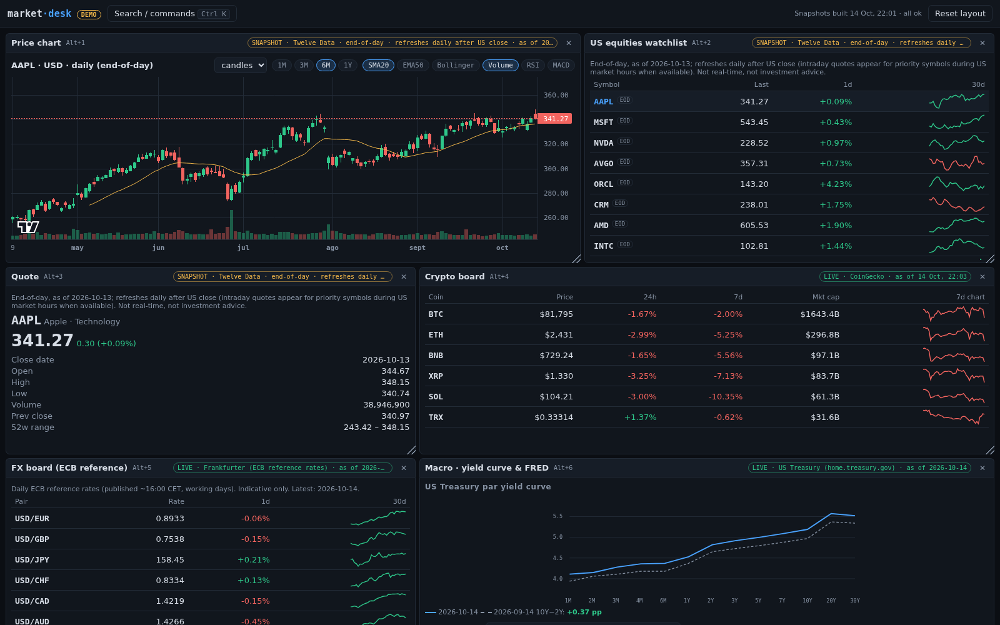
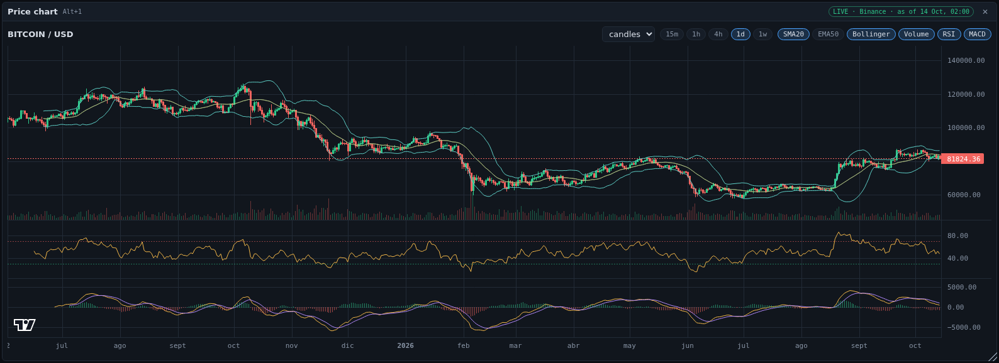
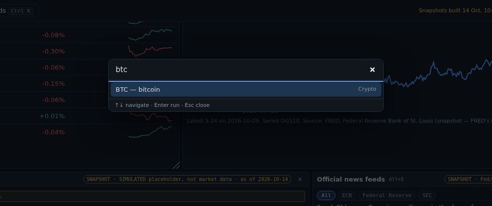
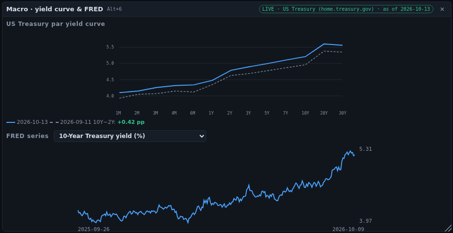
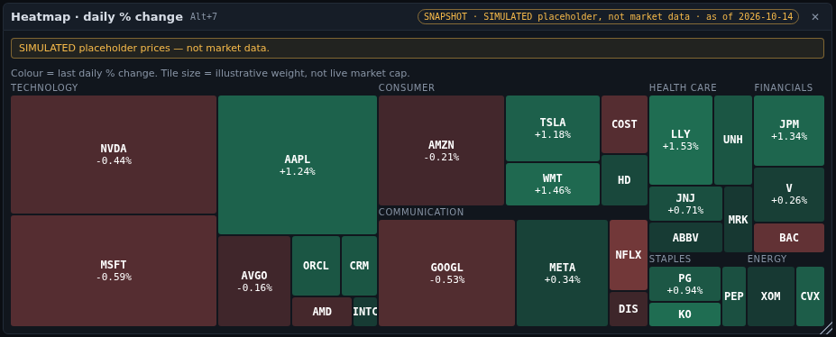
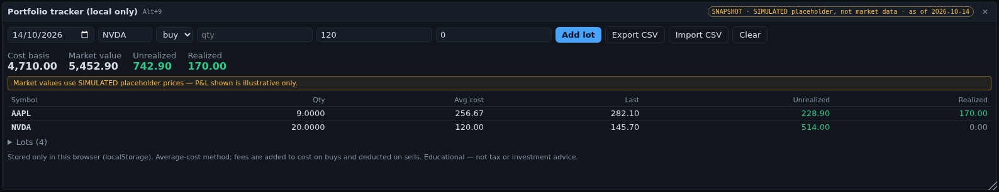
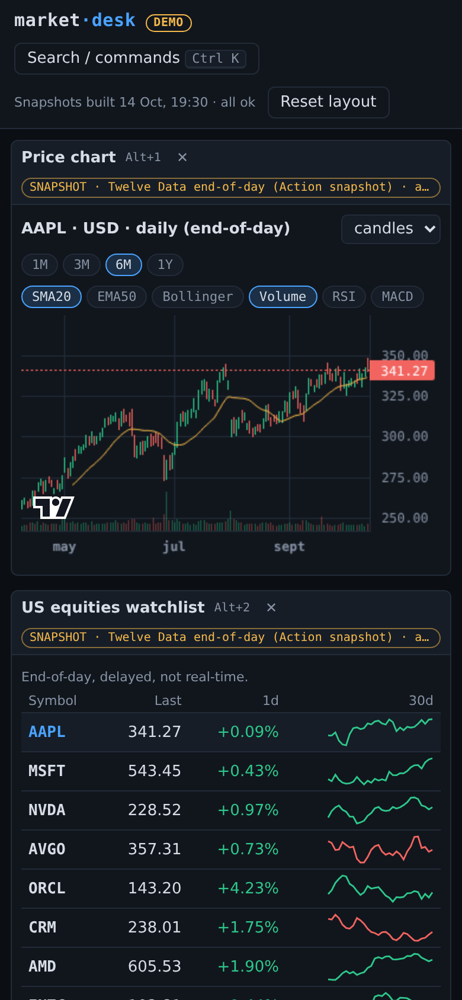
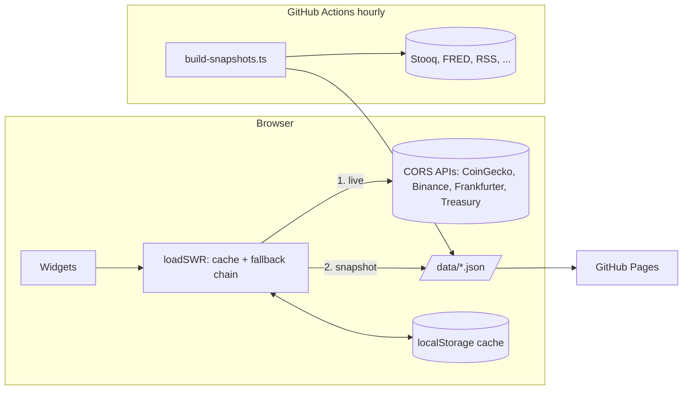

# market-desk

A keyboard-driven, dark, dense **market terminal** that runs 100% static on GitHub Pages: a draggable widget workspace, a command palette, charts with indicators, crypto / FX / macro boards, an end-of-day equities watchlist, official news feeds, a local portfolio tracker and a heatmap. No backend, no API keys in the browser.

**Live demo: https://alfiochoa.github.io/market-desk/** · [](https://github.com/alfiochoa/market-desk/actions/workflows/ci.yml)



> **Demo / educational only. Not investment advice.** Data is delayed, indicative or end-of-day and can be stale or wrong. Every panel carries a badge with its **source, as-of time and state** (`LIVE`, `CACHED`, `SNAPSHOT`, `ERROR`). Equities (Twelve Data, free shared key) are **end-of-day, refreshed daily after the US close**, plus **delayed intraday quotes for 15 priority symbols about every 30–60 min in US market hours** (best-effort GitHub cron, provisional, volume may be partial) — **never real-time**; if no real baseline exists the snapshot is explicitly labelled **SIMULATED** (see [Limitations](#honest-limitations)). Not affiliated with, endorsed by or sponsored by any data provider.

## Why

Free public market data is scattered across APIs that go down, rate-limit, or lack CORS. This project is a reference for building a *resilient* data UI on a static host: every widget has a fallback chain, a stale-while-revalidate cache and a visible provenance badge, so one provider outage degrades a panel instead of blanking the page.

## Gallery (taken with headless Chromium from the deployed site)

| | |
|---|---|
|  **Chart**: candles/line/area, volume, SMA, EMA, Bollinger, RSI, MACD (own implementations, unit-tested). Live BTC/USD from Binance public market data. |  **Command palette** (`Ctrl/⌘+K`): symbols, jump to / add widgets, reset layout. |
|  **Macro**: US Treasury par yield curve (latest vs ~1 month earlier) and FRED series. |  **Heatmap**: treemap by sector, coloured by daily % change (own d3-hierarchy layout). |
|  **Portfolio** (localStorage): lots, average cost, realized/unrealized P&L, CSV export/import. |  **Responsive**: panels stack on small screens. |

## Features

1. **Workspace**: drag headers to move, drag the corner to resize (keyboard: focus a header, arrows move, Shift+arrows resize). 12-column grid, layout saved in `localStorage`, *Reset layout* button, close/re-add any widget from the palette.
2. **Command palette** `Ctrl/⌘+K`, and **`Alt+1…9`** to focus the Nth panel.
3. **Price chart** with timeframes and indicators (see [Indicators](#indicators)); [lightweight-charts](https://github.com/tradingview/lightweight-charts) (Apache-2.0) is used for rendering only.
4. **Crypto board** with 7-day sparklines.
5. **FX board** (ECB reference rates).
6. **Macro**: Treasury yield curve + FRED series.
7. **US equities watchlist + quote panel** from an end-of-day snapshot.
8. **News**: official RSS headlines (Fed, ECB, SEC), deduplicated; links open the publisher.
9. **Portfolio tracker** (browser-only).
10. **Heatmap** of the watchlist by daily % change.

### Indicators

`src/lib/indicators.ts`: SMA, EMA (SMA-seeded), Bollinger (population σ), Wilder RSI, MACD(12,26,9). Tests check hand-computed values, the textbook Bollinger example (mean 5, σ 2 → bands 1 and 9) and the published Wilder/StockCharts RSI worked example (70.53, 66.32, 66.55, 69.41, 66.36, 57.97).

## Data sources

| Widget | Primary (browser, direct) | Fallback chain | Terms / licence |
|---|---|---|---|
| Crypto board | [CoinGecko public API](https://www.coingecko.com/en/api) | Binance public market data (`data-api.binance.vision`) → Action snapshot | CoinGecko: free API requires attribution ("Powered by CoinGecko") and is rate-limited. Binance: public market-data endpoints under [Binance Terms of Use](https://www.binance.com/en/terms). |
| Crypto chart | Binance public klines | CoinGecko OHLC (no volume) → 7-day sparkline snapshot | as above |
| FX | [Frankfurter](https://frankfurter.dev) (ECB reference rates) | Action snapshot | Free, open source, no key. ECB reference rates are indicative, published once per working day; free reuse with source attribution. |
| Yield curve | [US Treasury daily par yield curve](https://home.treasury.gov/resource-center/data-chart-center/interest-rates) XML | Action snapshot | US government data (public domain). |
| FRED series (DGS10, T10Y2Y, FEDFUNDS, UNRATE) | *none*: `fredgraph.csv` sends no CORS headers | Action snapshot (CSV fetched server-side, no key) | [FRED](https://fred.stlouisfed.org/) data, Federal Reserve Bank of St. Louis; cite the source, not endorsed by the St. Louis Fed. Only series published by the Fed / US Treasury / BLS are used; no S&P/NASDAQ/CBOE-licensed series. |
| US equities | *none* (browsers can't call EOD sources) | Action snapshot from **Twelve Data** (free key as repo secret), refreshed once per weekday after the US close; the committed `public/data/equities.json` is the baseline; if the API is unavailable the previous snapshot is kept and the badge says so | Twelve Data free-plan terms apply. Stooq blocks scripted clients (403 / browser verification) — that access control is **not bypassed** and Stooq is not used. |
| News | *none* (feeds lack CORS) | Action snapshot of [Federal Reserve](https://www.federalreserve.gov/feeds/feeds.htm), [ECB](https://www.ecb.europa.eu/rss/), [SEC](https://www.sec.gov/news/pressreleases.rss) RSS | Official feeds; only headline + link are stored. Fetched ≤ once/hour with an identifying User-Agent (SEC fair-access). |

Libraries: lightweight-charts (Apache-2.0; its attribution logo is kept on charts), d3-hierarchy (ISC), Vite (MIT).

## Architecture (short; details in [docs/ARCHITECTURE.md](docs/ARCHITECTURE.md))



Each source is a `Provider` (`live` or `snapshot`). `loadSWR` serves a fresh cache without network, serves a stale entry immediately while revalidating, walks the chain with a per-provider timeout, and on total failure keeps stale data (with a note) or shows an explicit error with *Retry*. The hourly **Build snapshots & deploy Pages** workflow rebuilds `public/data/*.json` (each source independent; failure keeps the previous file and is shown in the header's health line), builds the site and deploys it; once a day it also commits the snapshots as a fallback baseline.

## Run locally

```bash
git clone https://github.com/alfiochoa/market-desk && cd market-desk
npm ci
npm run dev        # http://localhost:5173
```

Other scripts (`scripts/gallery.mjs` re-takes the screenshots from the deployed site; `scripts/video/` records and assembles the demo video): `npm test` (unit), `npm run build && npm run e2e` (Playwright smoke), `npm run lint`, `npm run typecheck`, `npm run snapshots` (rebuild `public/data`).

## Quality

**45 unit tests (vitest) + 11 Playwright smoke tests**, all green in CI.

* **Unit tests (vitest)**: indicators vs reference values, P&L math and CSV round-trip, layout engine (no overlap), fallback chain / SWR cache / timeout / corrupt storage with mocked `fetch`, provider normalisation (CoinGecko → Binance → snapshot), RSS dedupe, Treasury XML, Stooq and Twelve Data parsers.
* **Playwright smoke (CI)**: loads the *built* site with provider APIs mocked by fixtures; asserts every widget renders with its badge, the palette opens and navigates, `Alt+2` focus, portfolio persistence, drag + persisted layout + reset, a **full provider outage** (all live widgets fall back to snapshots and say so) and a **snapshot failure** (explicit error, not a blank panel).
* **CI**: ESLint, `tsc`, tests, build, dependency-free secret scan (tracked files and full history), Playwright.

## Honest limitations

* **Equities are not real-time.** Mode and data time are on every badge: `end-of-day · refreshes daily after US close · as of <date>` or `intraday, delayed + end-of-day · refreshes ~every 30–60 min in US market hours (best-effort) · as of HH:MM UTC`. Only 15 priority symbols get intraday quotes (tagged `intraday` in the watchlist; the rest are tagged `EOD`); the chart's last candle is drawn in amber and labelled provisional. Intraday runs are skipped outside 13:30–21:00 UTC weekdays and when `is_market_open` is false (a 1-credit probe). GitHub cron is best-effort, so cadence is "about every 30–60 min", not exact. If the credit limit is hit, the previous data is kept and flagged. EOD has no holiday calendar (same last bar re-fetched on a holiday, a few credits).
* Crypto/FX/yield-curve panels call third-party APIs from your browser; they can be rate-limited or geo-blocked (Binance's main host is blocked in some countries; the public market-data mirror is used). Falling back is automatic and visible.
* FRED, news and equities only update when the Action runs (hourly, best effort: GitHub may delay scheduled jobs).
* Heatmap tile size uses *illustrative* weights, not live market caps. The yield curve compares the latest date with ~21 trading days earlier.
* Portfolio is browser-local (clearing site data deletes it), average-cost only, no taxes/FX/splits/dividends.
* No trading, no alerts, no accounts. Not investment advice.

## Credits

Concept inspired by the idea of a widget-based market workspace (e.g. OpenTerminal). All code, layout, copy and name here are original; no code, text or assets were copied and none of its unofficial endpoints are used.

MIT licensed.

## Twelve Data credit budget (shared key)

The free Twelve Data plan gives **800 credits/day, 8/minute**; one symbol = 1 credit (`/time_series` and `/quote`). The author's key is shared with another project (`sp500-tracker`, ≤ 320 credits per weekday), so market-desk is budgeted to **≤ 250 credits/day in total**:

| Project | Credits/day |
|---|---|
| market-desk EOD (30 symbols, once per weekday after the close) | 30 |
| market-desk intraday (15 symbols × ≤ 14 market-hours runs + ≤ 2 one-credit probes) | ≤ 212 |
| **market-desk worst case** (`worstCaseDailyCredits()`, unit-tested ≤ 250) | **242** |
| sp500-tracker | ≤ 320 on weekdays |
| Total | < 800 |

Rules in `scripts/build-snapshots.ts`: EOD data is fetched **only** by the 23:xx UTC weekday run or a manual run with `refresh_equities=true`, only for symbols older than the last trading day (cap `MAX_CREDITS_PER_RUN = 40`); intraday quotes only on scheduled runs or a manual `refresh_intraday=true`, inside 13:30–21:00 UTC weekdays, at least 25 min apart, after a 1-symbol `is_market_open` probe; pushes never call the API. The log prints `twelvedata credits used: N (day total ~M, estimate)`. HTTP 429 / "run out of API credits" keeps the previous data. **If you fork this, use your own free key** (repo secret `TWELVE_DATA_API_KEY`).
