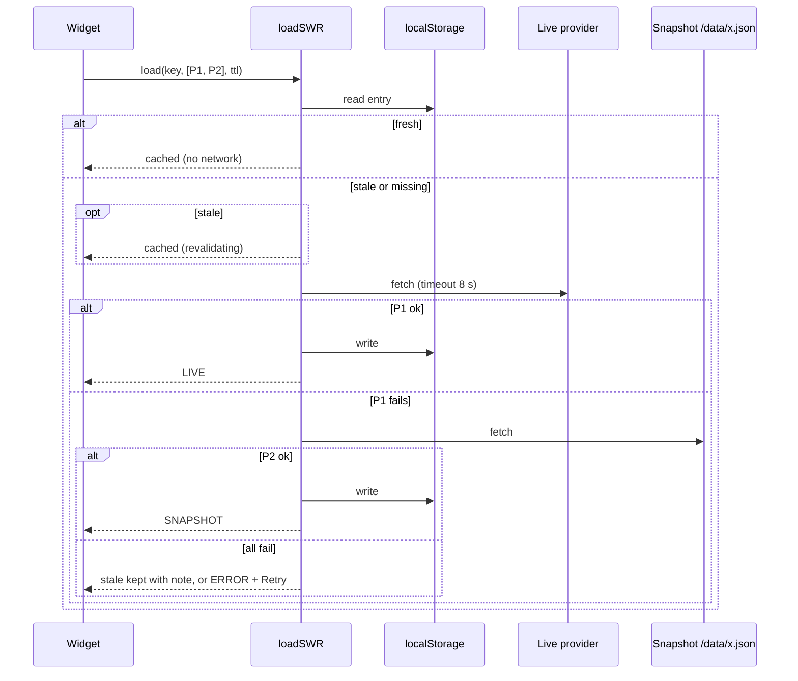

# Architecture

## Goals
Static hosting (GitHub Pages), no backend, no secrets in the client, and **no single provider outage may blank the UI**.

## Modules
| Path | Role |
|---|---|
| `src/core/data.ts` | `Provider` interface, `fetchChain` (ordered fallback, per-provider timeout via `AbortController`), `loadSWR` (localStorage stale-while-revalidate) |
| `src/core/widget.ts` | Per-panel context: loads through `loadSWR`, drives the provenance badge, renders explicit errors with *Retry*, isolates render exceptions |
| `src/core/workspace.ts` | Grid workspace: pointer + keyboard drag/resize, persistence (`md:layout:v1`), add/remove/reset, Alt+N order |
| `src/core/palette.ts` | `Ctrl/⌘+K` palette: scored filtering, listbox ARIA, symbol/widget/action commands |
| `src/core/bus.ts` | Selected-instrument bus and a tiny shared store (equity snapshot shared by watchlist, quote, heatmap, portfolio, chart) |
| `src/sources/providers.ts` | Every source as a fallback chain (CoinGecko → Binance → snapshot, Frankfurter → snapshot, Treasury → snapshot, FRED/equities/news snapshot only) |
| `src/lib/*` | Pure, unit-tested logic: indicators, portfolio P&L + CSV, layout engine, RSS parse/dedupe, Treasury XML, FRED CSV, Stooq/Twelve Data parsers and credit budget, deterministic simulator |
| `src/widgets/*` | The nine widgets (`chart`, `boards`, `info`) registered in `registry.ts` |
| `scripts/build-snapshots.ts` | Node (type-stripping) snapshot builder run by Actions; shares `src/lib` parsers with the app |

## Data flow

## Provenance badge states
`LIVE` fetched now from the origin API · `CACHED` served from this browser's cache (hover shows if a refresh failed) · `SNAPSHOT` file built by the Action (as-of shown) · `ERROR` every source failed. Equity snapshots built from the placeholder generator say `SIMULATED placeholder`.

## Snapshot pipeline (`.github/workflows/pages.yml`)
Hourly (+ on push and manually): `build-snapshots.ts` → `vite build` → deploy to Pages. Each source step is isolated; failure keeps the previous file and is recorded in `meta.json` (shown in the header). Equities are the exception: real data (Twelve Data, 1 credit/symbol, key shared with another project, cap `MAX_CREDITS_PER_RUN = 40`) is fetched only by the 23:xx UTC weekday run or a manual run with `refresh_equities=true`, only for symbols older than the last trading day; in-progress session bars are dropped so the snapshot is strictly end-of-day; the baseline is committed right after the refresh and reused by every other run; 429 / out-of-credits keeps the previous snapshot and flags it in the badge. Other sources are committed daily at 05 UTC. Stooq is not used (403 / verification page is an access control we do not bypass). The key is only passed through the environment and never logged.

## Why these choices
* **Own layout engine** (≈40 lines, tested) instead of a grid library: fewer dependencies, full control of keyboard support.
* **SVG for sparklines/curves, lightweight-charts for time series**: small bundle (~75 kB gzip total).
* **`fredgraph.csv` and RSS via Action**: neither sends CORS headers, so a browser cannot read them; proxies were avoided on purpose.
* **Shared TypeScript parsers** between the app and the Node script keep one tested implementation per format.

## Twelve Data free plan: what `/quote` really returns (probed once, 2026-10-14 19:55:32 UTC, 2 credits)

`GET /quote?symbol=AAPL` on the free key returned HTTP 200 with: `datetime` (session date), `timestamp` (session open, epoch), **`last_quote_at`** (epoch of the latest quote; 19:55:00 UTC, i.e. ≤ 1 min before the request), `open/high/low/close` (`close` = current price while the session is open), `volume`, `previous_close`, `change`, `percent_change`, `average_volume`, `fifty_two_week`, and **`is_market_open: true`**. `GET /price` returned only `{"price":"342.7"}` (no timestamp, so unusable for honest labelling) and differed from `/quote`'s `close` (343.375), i.e. the two endpoints are not snapshots of the same instant.

What the response does **not** prove: that this is the consolidated tape. The day volume was 1.75 M against a 30.8 M average with ~6.4 h of the session elapsed, which suggests a partial/single-venue feed. So the app never says "real-time": intraday quotes are labelled *delayed, provisional*, show the `last_quote_at` time in UTC and the feed age measured when the Action fetched them, and note that volume may be partial. Because the Action only runs about every 30–60 min (GitHub cron is best-effort), the data shown is typically 0–60 min old regardless of the feed's own latency.

Intraday design: `intraday.json` (15 priority symbols) is generated by scheduled runs and **not committed**; it is deployed with the site, and push-triggered builds re-download the last deployed copy so a push never drops the quotes. The browser merges it onto the EOD history only when the quote's session date is newer than the last EOD bar (so it vanishes by itself once the daily EOD refresh lands). The baseline commit still happens only after the daily EOD refresh.
