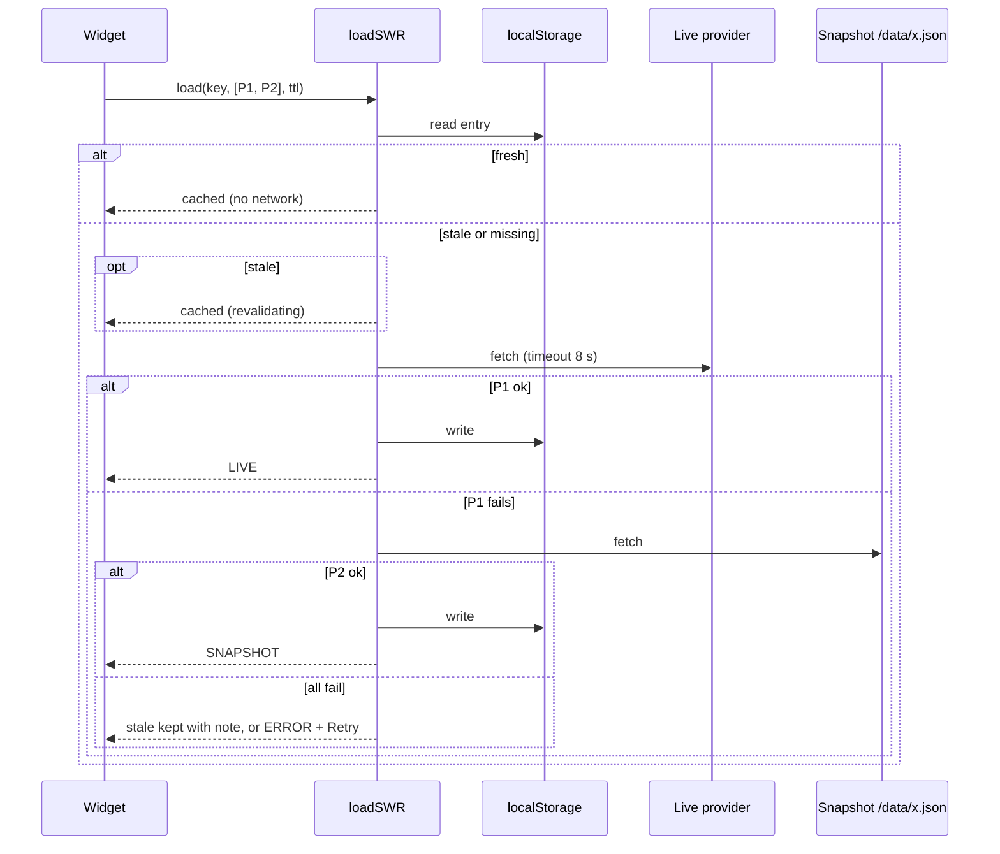

# Architecture

## Goals
Static hosting (GitHub Pages), no backend, no secrets in the client, and **no single provider outage may blank the UI**.

## Modules
| Path | Role |
|---|---|
| `src/core/data.ts` | `Provider` interface, `fetchChain` (ordered fallback, per-provider timeout via `AbortController`), `loadSWR` (localStorage stale-while-revalidate) |
| `src/core/widget.ts` | Per-panel context: loads through `loadSWR`, drives the provenance badge, renders explicit errors with *Retry*, isolates render exceptions |
| `src/core/workspace.ts` | Grid workspace: pointer + keyboard drag/resize, persistence (`md:layout:v1`), add/remove/reset, Alt+N order |
| `src/core/palette.ts` | `Ctrl/⌘+K` palette: scored filtering, listbox ARIA, symbol/widget/action commands |
| `src/core/bus.ts` | Selected-instrument bus and a tiny shared store (equity snapshot shared by watchlist, quote, heatmap, portfolio, chart) |
| `src/sources/providers.ts` | Every source as a fallback chain (CoinGecko → Binance → snapshot, Frankfurter → snapshot, Treasury → snapshot, FRED/equities/news snapshot only) |
| `src/lib/*` | Pure, unit-tested logic: indicators, portfolio P&L + CSV, layout engine, RSS parse/dedupe, Treasury XML, FRED CSV, Stooq/Twelve Data parsers, deterministic simulator |
| `src/widgets/*` | The nine widgets (`chart`, `boards`, `info`) registered in `registry.ts` |
| `scripts/build-snapshots.ts` | Node (type-stripping) snapshot builder run by Actions; shares `src/lib` parsers with the app |

## Data flow

## Provenance badge states
`LIVE` fetched now from the origin API · `CACHED` served from this browser's cache (hover shows if a refresh failed) · `SNAPSHOT` file built by the Action (as-of shown) · `ERROR` every source failed. Equity snapshots built from the placeholder generator say `SIMULATED placeholder`.

## Snapshot pipeline (`.github/workflows/pages.yml`)
Hourly (+ on push and manually): `build-snapshots.ts` → `vite build` → deploy to Pages. Each source step is isolated; failure keeps the previous file and is recorded in `meta.json` (shown in the header). Once a day the job commits `public/data` so the repository copy (the last-resort fallback) stays fresh. Stooq is tried first; HTTP 403 / verification pages are treated as "blocked" and are not circumvented. With a `TWELVE_DATA_API_KEY` secret the builder fetches 8 symbols/minute (free-tier limit) at most once per 20 h; the key is only passed through the environment and never logged.

## Why these choices
* **Own layout engine** (≈40 lines, tested) instead of a grid library: fewer dependencies, full control of keyboard support.
* **SVG for sparklines/curves, lightweight-charts for time series**: small bundle (~75 kB gzip total).
* **`fredgraph.csv` and RSS via Action**: neither sends CORS headers, so a browser cannot read them; proxies were avoided on purpose.
* **Shared TypeScript parsers** between the app and the Node script keep one tested implementation per format.
